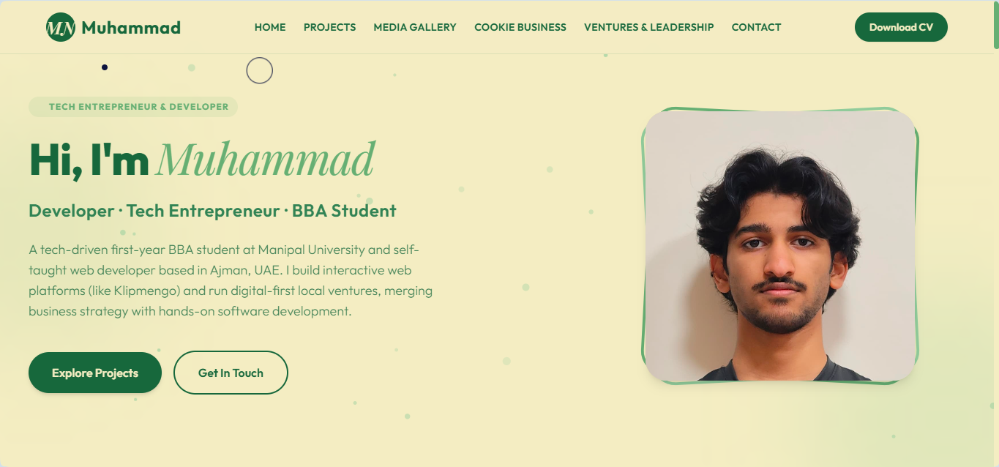
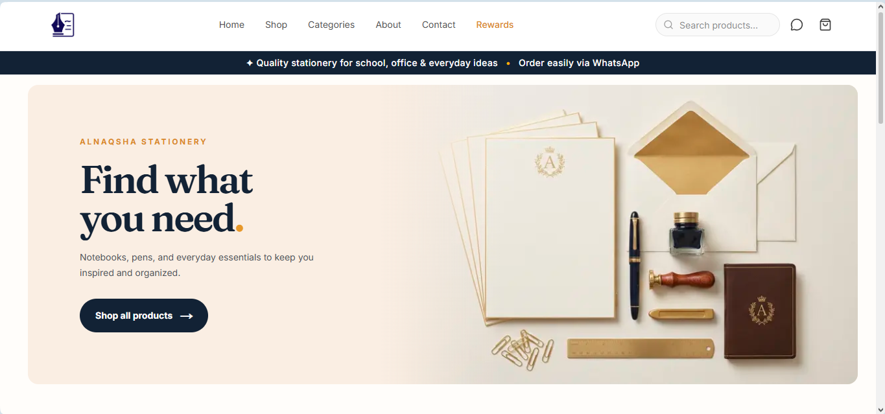

# Muhammad — Personal Portfolio 🌱

A fast, interactive personal portfolio for **Muhammad** — tech entrepreneur, self-taught web developer, and first-year BBA student at Manipal University (Ajman, UAE).

Live site: **https://motcha.netlify.app**



> Save the hero screenshot you sent as `media/portfolio_preview.png` to show it here.
> Current placeholder mockups: `media/motcha_mockup.png`, `media/klipmengo_mockup.png`

---

## ✨ What's inside

- **Hero** — intro, portrait card, CTA buttons, particle background
- **Featured Web Projects**
  - `Klipmengo LMS` — 🚧 **Upcoming / in development** (no public link yet, teaser card only)
  - `Motcha Portfolio` — ✅ Live interactive UI ([motcha.netlify.app](https://motcha.netlify.app))
  - `Alnaqsha.ae` — ✅ Live e-commerce store ([alnaqsha.ae](https://alnaqsha.ae))
- **Media Gallery** — carousel with photos + videos (leadership, wellness events, baking)
- **Cookie Business** — bakery menu log, operations metrics
- **Ventures & Leadership** — animated counters, sales dashboard
- **Certificates + Resume** — PDF view / download cards
- **Contact** — info cards + form
- **Effects** — custom elastic cursor, canvas particles that morph per section (💻 / 🍪 / 📈), click ripples, scroll animations

## 🛠️ Stack

- Static — no build step, no Node required
- `HTML5` + `Tailwind CSS (CDN)` + vanilla `ES6 JS` + `Canvas API`
- Fonts: Outfit, Playfair Display, Playpen Sans
- Hosting: Netlify (static)

```
index.html   → structure + content
styles.css   → theme, cursor, bakery/sales themes, mockups
script.js    → particles, cursor, carousel, counters, drawer, form
media/       → images, videos, mockups
resume/      → CV PDF
certificates/→ credentials PDF
```

## 🚀 Run locally

No install needed. Just open it:

```bash
# option 1 — double-click index.html
# option 2 — serve it
npx serve .
# or
python -m http.server 8000
```

Then visit `http://localhost:8000` (or the port shown).

## 📸 Screenshots

| Portfolio | Alnaqsha.ae |
|---|---|
|  |  |

Save the two images you sent as:

- `media/portfolio_preview.png` — first screenshot (Muhammad hero)
- `media/alnaqsha_preview.png` — second screenshot (Alnaqsha storefront)

Once added, they will render automatically in this README and you can also swap them into the project cards in `index.html`.

> Tip: keep images under ~500KB (export JPG quality 80) for fast loads.

## 🌐 Projects

### 1. Klipmengo LMS — Upcoming
Modular multi-tenant school collaboration + learning platform: role dashboards (supervisor / teacher / parent / student), auto substitutes, merit points, QR desktop-to-mobile auth. **Status: in development — no public URL.**

### 2. Motcha Portfolio — Live
This repo. High-performance portfolio with scroll animations, elastic cursor, morphing particle physics.

→ https://motcha.netlify.app

### 3. Alnaqsha.ae — Live client project
Live e-commerce for Al Naqsha Stationery LLC — shop catalog, categories, search, cart, WhatsApp ordering, rewards, about/contact pages. Built with Next.js + Supabase.

→ https://alnaqsha.ae


## 📂 Deploy

Any static host works (Netlify / Vercel / GitHub Pages / Cloudflare Pages). Draft for Netlify:

- Build command: _(none)_
- Publish directory: `.`
- Or drag-and-drop the folder into Netlify Drop.

## 📬 Contact

- Email: allocator123@gmail.com
- Phone/WhatsApp: +971-526344210
- Instagram: [@busi.motcha](https://instagram.com/busi.motcha)
- LinkedIn: [Muhammad Naeem](https://www.linkedin.com/in/muhammad-naeem-b998a723b)
- Location: Ajman, UAE

---

© 2026 Muhammad. All rights reserved.
